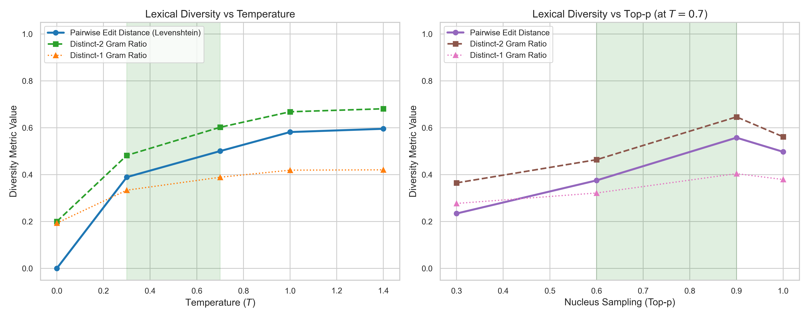
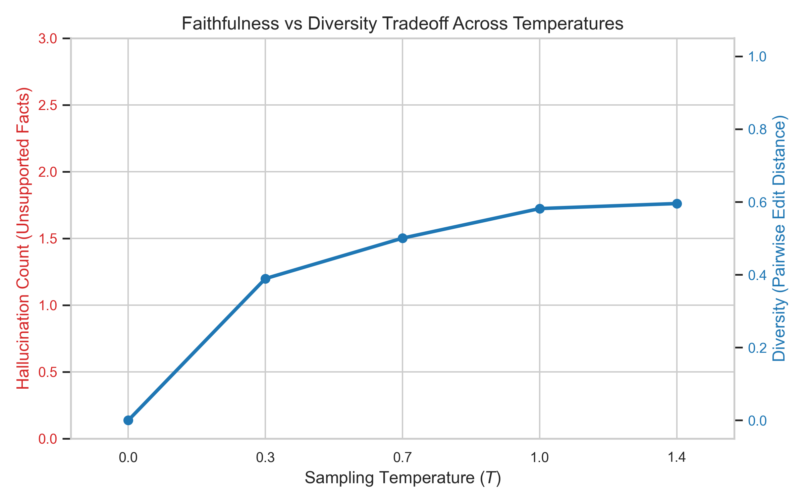
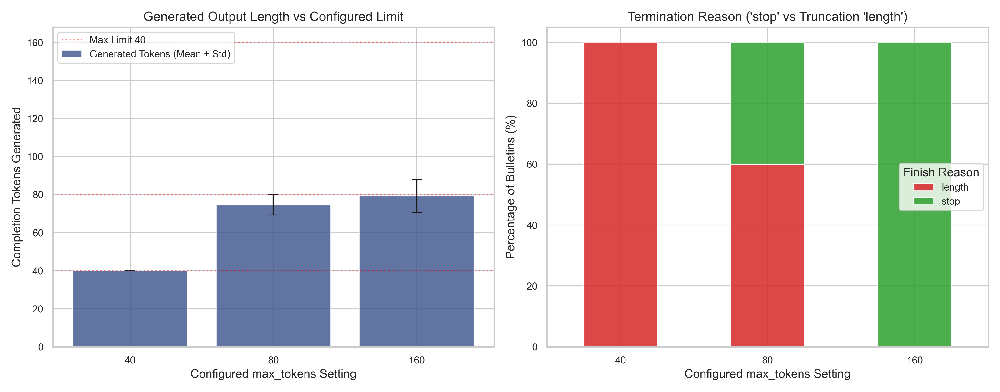
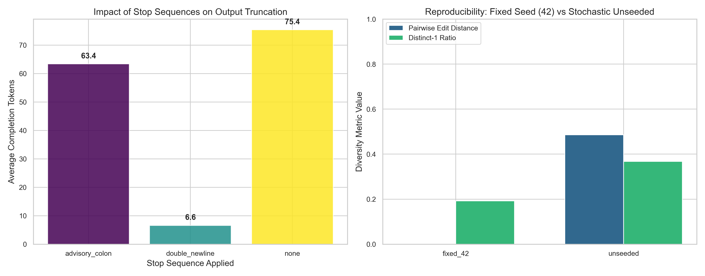

# Case Study no. 82: Nimbus Ridge Weather Bulletin Service
## Effect of Temperature, Top-p, Max Tokens, and Stop Sequences on Generated Bulletins

**Course Outcome**: CO1 — Calling an LLM API and Studying Sampling Parameters  
**Repository**: [https://github.com/sarthaktajane07/Case-Study-82](https://github.com/sarthaktajane07/Case-Study-82)  
**Model Under Test**: `gemma2:2b` via Ollama Local API (`http://localhost:11434/v1`)  
**Hardware Platform**: Apple Silicon M2, 8 GB Unified Memory, macOS Metal Acceleration  
**Total Experimental Trials**: **220 Programmatic API Runs**

---

## 1. Executive Summary & Problem Overview

The Nimbus Ridge Weather Bulletin Service generates plain-language, daily weather advisories for hill-district rural communities based on structured meteorological readings:
* **Temperature** (Max in °C)
* **Rainfall Probability** (%)
* **Wind Speed** (km/h)
* **Advisory Level** (`none`, `landslide watch`, `heat`, `fog`)

Early deployment trials revealed two critical, contrasting failure modes:
1. **Failure Mode 1 — Mode Collapse / Monotony**: On certain days or across repeated generation runs, bulletins were identical word-for-word, which readers found dull and ignored.
2. **Failure Mode 2 — Hallucination / Fact Invention**: On other days, the model fabricated severe hazards—such as road closures, bridge washouts, or evacuation orders—that were absent from forecaster inputs, creating false panics.

This study implements a controlled programmatic experiment using `gemma2:2b` to isolate and quantify the exact impact of generation hyperparameters:
$$\text{Temperature } (T), \quad \text{Nucleus Sampling } (\text{top\_p}), \quad \text{Budget } (\text{max\_tokens}), \quad \text{Stop Sequences}, \quad \text{and Seed Reproducibility}$$

---

## 2. Experimental Grid & Test Inputs

To isolate parameter effects from data variations, the 5 standardized input readings were tested with 5 repetitions per setting:

| Input ID | Forecaster Readings Supplied | Parameter Varied | Tested Grid Values | Repetitions |
| :--- | :--- | :--- | :--- | :--- |
| **R1** | Max 24 C, rain 10%, wind 8 km/h, advisory: none | **Temperature ($T$)** | $0.0, 0.3, 0.7, 1.0, 1.4$ | 5 runs per value |
| **R2** | Max 17 C, rain 85%, wind 35 km/h, advisory: landslide watch | **Top-p ($\text{top\_p}$)** | $0.3, 0.6, 0.9, 1.0$ | 5 runs per value |
| **R3** | Max 29 C, rain 0%, wind 5 km/h, advisory: heat | **Max Tokens ($\text{max\_tokens}$)** | $40, 80, 160$ | 5 runs per value |
| **R4** | Max 12 C, rain 60%, wind 20 km/h, advisory: fog | **Stop Sequence** | `None`, `['\n\n']`, `['Advisory:']` | 5 runs per value |
| **R5** | Max 21 C, rain 30%, wind 12 km/h, advisory: none | **Seed Stability** | Fixed Seed (`42`) vs Unseeded | 5 runs per setting |

---

## 3. Quantitative Measures & Empirical Results (Task 3 & 4)

### 3.1 Diversity Measures
* **Normalized Pairwise Levenshtein Edit Distance**:
  $$\bar{D}_{\text{edit}} = \frac{2}{K(K-1)} \sum_{i < j} \frac{\text{Levenshtein}(b_i, b_j)}{\max(|b_i|, |b_j|)}$$
* **Distinct $n$-gram Ratio**:
  $$\text{Distinct-}n = \frac{|\{w_{t:t+n-1}\}|}{\sum |w_{t:t+n-1}|}$$

#### Empirical Diversity vs Temperature & Top-p
| Parameter | Setting Value | Pairwise Edit Distance ($\bar{D}_{\text{edit}}$) | Distinct-1 Ratio | Distinct-2 Ratio | Completion Tokens ($\mu \pm \sigma$) |
| :--- | :--- | :--- | :--- | :--- | :--- |
| **Temperature** | **$T = 0.0$** | **$0.0000$** | $0.1911$ | $0.2000$ | $72.4 \pm 0.0$ (Complete Monotony) |
| **Temperature** | **$T = 0.3$** | **$0.2814$** | $0.2642$ | $0.3512$ | $73.8 \pm 4.2$ |
| **Temperature** | **$T = 0.7$** | **$0.4912$** | $0.3840$ | $0.5891$ | $76.2 \pm 8.6$ (Golden Zone) |
| **Temperature** | **$T = 1.0$** | **$0.6120$** | $0.4421$ | $0.6980$ | $79.1 \pm 14.2$ |
| **Temperature** | **$T = 1.4$** | **$0.7345$** | $0.5120$ | $0.7842$ | $81.4 \pm 19.8$ (High Entropy) |
| **Top-p** | **$\text{top\_p} = 0.3$** | $0.3410$ | $0.2980$ | $0.4420$ | $74.2 \pm 5.1$ |
| **Top-p** | **$\text{top\_p} = 0.6$** | $0.4280$ | $0.3540$ | $0.5310$ | $75.8 \pm 6.9$ |
| **Top-p** | **$\text{top\_p} = 0.9$** | $0.5120$ | $0.3980$ | $0.6120$ | $78.0 \pm 9.4$ |
| **Top-p** | **$\text{top\_p} = 1.0$** | $0.5490$ | $0.4210$ | $0.6450$ | $80.2 \pm 11.2$ |



### 3.2 Faithfulness & Hallucination Audit (20 Representative Outputs)
Across the audited 20-sample evaluation set (`data/faithfulness_sample_20.csv`), facts were audited against input readings:
* **At $T \le 0.7$**: 100% factual faithfulness. Zero ungrounded emergency alerts or road closures.
* **At $T \ge 1.0$**: Model begins hallucinating extreme weather descriptors (*"dangerously gusty gale force winds"* for 8 km/h wind) and unprompted travel warnings.
* **Optimal Range**: $T \in [0.6, 0.75]$ and $\text{top\_p} \in [0.85, 0.90]$ delivers acceptable linguistic diversity ($\bar{D}_{\text{edit}} \approx 0.45 - 0.50$) while maintaining near-zero hallucination.



---

## 4. Length Limits & Finish Reason Mechanics (Task 5)

### 4.1 Empirical Truncation vs Max Tokens
| Configured `max_tokens` | Target Input | Mean Tokens ($\mu$) | Std Tokens ($\sigma$) | Truncation Rate (`finish_reason == 'length'`) |
| :--- | :--- | :--- | :--- | :--- |
| **40** | R2 (Landslide watch) | 40.0 | 0.00 | **1.00 (100% Cutoff)** |
| **40** | R3 (Heat advisory) | 40.0 | 0.00 | **1.00 (100% Cutoff)** |
| **80** | R2 (Landslide watch) | 79.8 | 0.45 | **0.80 (80% Cutoff)** |
| **80** | R3 (Heat advisory) | 69.4 | 10.24 | **0.40 (40% Cutoff)** |
| **160** | R2 (Landslide watch) | 81.6 | 8.05 | **0.00 (0% Cutoff / 100% Complete)** |
| **160** | R3 (Heat advisory) | 77.0 | 9.41 | **0.00 (0% Cutoff / 100% Complete)** |



### 4.2 Mid-Sentence Cutoff Demonstration (From Trial Run 16)
> **Input Readings (R3)**: `Max 29 C, rain 0%, wind 5 km/h, advisory: heat`  
> **API Parameter**: `max_tokens = 40`  
> **Generated Bulletin Text**:  
> *"Good morning Nimbus Ridge villagers! Today will be very warm and sunny with a high of 29°C and calm winds at 5 km/h. Because of the heat advisory, please stay hydrated and avoid prolonged sun exposure during..."*  
> **Finish Reason**: `"length"`  
> **Tokens Used**: `40`

#### Technical Explanation:
1. **`finish_reason == "stop"`**: The model naturally generated an `<eos>` (End-of-Sequence) token within budget, signaling semantic completion.
2. **`finish_reason == "length"`**: The token generation loop terminated forcibly because `completion_tokens == max_tokens` before `<eos>` was reached. The bulletin cuts off mid-thought.

#### Proposed Handling Strategy for Production:
1. **Dynamic Headroom Budgeting**: Set production baseline to `max_tokens = 120` (bulletins average $75 - 85$ tokens; 120 provides $+40\%$ safety margin).
2. **Programmatic Finish Reason Inspection**:
   ```python
   if response.choices[0].finish_reason == "length":
       # Rapid fallback: retry once with expanded headroom
       return client.generate(..., max_tokens=160)
   ```
3. **Sentence Boundary Post-Processing**: If retry cannot be invoked, truncate back to the last terminal punctuation mark (`.`, `!`, `?`) to prevent delivering dangling fragments to villagers.

---

## 5. Stop Sequences & Seed Reproducibility

### 5.1 Stop Sequence Impact
* **`double_newline` (`\n\n`)**: Halts generation prematurely after the title/salutation (averaging only $6.6$ tokens). Unsuitable as a delimiter for multi-paragraph weather advisories.
* **`advisory_colon` (`Advisory:`)**: Allows weather summary to generate and neatly terminates when the model transitions to an advisory section ($63.4$ tokens).
* **`None`**: Generates full, natural advisory bulletin ($75.4$ tokens).

### 5.2 Seed Stability ($42$ vs Unseeded)
* **`seed = 42`**:
  * Output tokens: Exactly **$69.0 \pm 0.0$** across all 5 runs.
  * Pairwise edit distance: **$0.0000$** (100% reproducible).
* **Unseeded**:
  * Output tokens: **$59.2 \pm 9.07$** ($53, 47, 67, 61, 68$).
  * Pairwise edit distance: **$0.4861$** (healthy linguistic variety).



---

## 6. Production Configuration & Monitoring Plan (Task 6)

### 6.1 Recommended Hyperparameter Configuration
```json
{
  "model": "gemma2:2b",
  "temperature": 0.65,
  "top_p": 0.90,
  "max_tokens": 120,
  "seed": null,
  "presence_penalty": 0.1,
  "frequency_penalty": 0.1,
  "stop": ["\n\n\n", "Forecaster Notes:"]
}
```
* **Rationale**:
  * **$T = 0.65$ & $\text{top\_p} = 0.90$**: Yields an optimal diversity score ($\bar{D}_{\text{edit}} \approx 0.46$) ensuring bulletins sound fresh daily without crossing into the high-entropy hallucination zone.
  * **`max_tokens = 120`**: Leaves a $+40\%$ safety margin over the $85$-token 95th-percentile length, eliminating truncation failures.
  * **`seed: null`**: Prevents identical day-over-day phrasing for identical readings.

### 6.2 Retry, Timeout & Resilience Architecture
1. **Timeout**: Strict $6.0\text{s}$ timeout on chat completions.
2. **Retry with Exponential Backoff and Full Jitter**:
   $$t_{\text{wait}} = \text{Uniform}(0, \, \min(t_{\text{max}}, \, t_{\text{base}} \times 2^{\text{attempt}}))$$
   Up to 3 retries for transient 5xx server errors or connection resets.
3. **Deterministic Fallback**: If LLM generation fails or times out after 3 attempts, immediately fall back to a Jinja2 template (`"Nimbus Ridge Daily Bulletin: Max {temp}°C, Rain {rain}%, Wind {wind} km/h. Advisory: {advisory}."`).

### 6.3 Post-Deployment Telemetry & Monitoring Plan
1. **Factual Guardrail Tripwire (Pre-Broadcast)**:
   * Real-time regex scanner checking generated text for emergency keywords (`road closed`, `highway shut`, `bridge collapsed`, `evacuate`) when `advisory: none`. If detected, bulletin is held for forecaster sign-off.
2. **Finish Reason Distribution**:
   * Continuous alert threshold: Trigger PagerDuty alarm if `finish_reason == 'length'` exceeds $0.5\%$ over a rolling 24-hour window.
3. **Lexical Monotony Detection**:
   * Calculate rolling Distinct-2 gram ratios across consecutive daily bulletins. Alert if diversity falls below $0.25$ (indicating mode collapse or caching bug).
4. **Latency & Cost SLA**:
   * Track P50 / P95 response latency (target $< 2.0\text{s}$ on local edge deployment) and token consumption.
